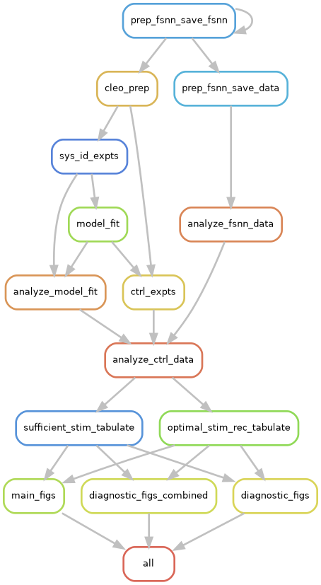
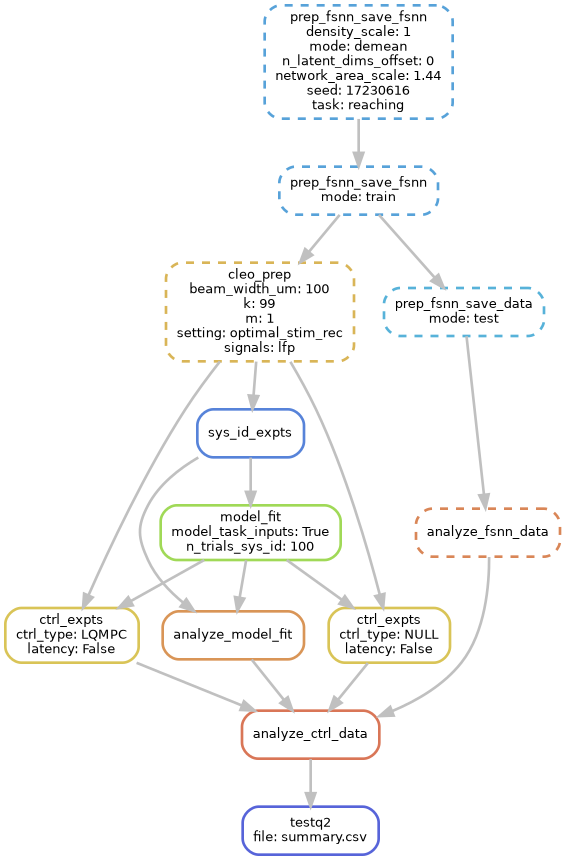

# Snakemake workflow: `control-of-latent-dynamics`

[](https://snakemake.github.io)
[](https://github.com/siplab-gt/control-of-latent-dynamics/actions?query=branch%3Amain+workflow%3ATests)

A Snakemake workflow for running all simulations and producing figures for "Closed-loop optogenetic control of latent dynamics".
This entails:

- training of [factor-based SNNs (fSNNs)](https://www.sciencedirect.com/science/article/pii/S0896627322010807)
- wrapping fSNNs with Cleo and producing system identification (training) input/output data via stimulation and recording
- fitting [BRAID](https://openreview.net/forum?id=3usdM1AuI3) dynamics models to said data to support latent factor inference and inform optimal control
- constructing optimal controllers from those fit dynamics models
- incorporating those controllers into Cleo to simulate complete closed-loop optogenetics experiments
- performing data analysis on results, computing error, latency, causal inference power, etc.
- exploring a large parameter space of different network and experimental features
- integrating results into final figures


## Installing dependencies

```bash
mamba env create -f workflow/envs/main.yaml
mamba activate cold
```
or use `workflow/envs/main-snapshot.yaml` to get the exact versions we used for the latest results.

Since Snakemake's conda method straight from the file struggles with the relative path to install the source package here, we just make sure to prepare the environment first.
Keep this environment up-to-date with the env file like so:
```bash
mamba env update -n cold -f workflow/envs/main.yaml --prune 
```

And the snapshot env file can be generated from the current environment like so:
```bash
conda env export -n cold --no-builds | grep -v '^prefix:' > workflow/envs/main-snapshot.yaml
```

## Usage

To produce the full result set, simply run `snakemake` with no arguments.

### Going deeper

The graphs generated by snakemake can help you see the relationship between different rules and where different condition parameters come into play:

| `snakemake --rulegraph \| dot -Tpng > rg.png` | `snakemake --dag results/testq2/summary.csv \| dot -Tpng > dag.png` |
| - | - |
|  |  |

To run the pipeline up to a desired point, ask for the file you want:
```
snakemake file.ext
```
As far as rules are configured with all relevant inputs and parameters, rules will only rerun if something has changed since the last time.
Files for individual conditions have long, cumbersome paths corresponding reflecting the exploratory parameters.
As a shortcut, use the `testq1` and `testq2` rules, which allow you to specify condition you want (default being reference) in the Snakefile:
```
snakemake results/testq1/model_fit_lds.pkl.gz
```

Read the Snakefile to see all potential targets, but here are some main ones to be aware of.
The following are condition-specific, so you will need to prepend the long condition-specific path or the `results/testq{1|2}` mentioned above to get them:
- `fsnn_post_train.pkl.gz`: the trained network
    - `fsnn_test_data_plot.png`: a giant plot of the test data to visually confirm that the network is following targets
    - `fsnn_test_data_analysis.csv`: key metrics of network performance on test data
- `cleo_plot.webp`: a 3D plot of the network with the Cleo electrode and light array interface
- `sys_id_data.pkl.gz`: data from sys ID experiments
    - `sys_id_wide_plot_exploded.png`: giant plot of the sys ID data. 'exploded' separates channels vertically so you can inspect them individually
- `model_fit_lds.pkl.gz`: the linear dynamical system model fit to the sys ID data
    - `model_fit_rollout_r2_plot.webp`: shows how well the system forecasts $n$ steps into the future, calculated from sys ID data
    - `model_fit_pred_plot_exploded.png`: plots sys ID data together with model predictions
    - `model_fit_analysis.csv`: key metrics of model fit quality
- `ctrl_data.pkl.gz`: data from closed-loop control experiments
    - `ctrl_data_wide_plot_exploded.png`: giant plot of the control data, with 'exploded' version separating channels vertically
- `summary.csv`: key metrics of control performance *and* from the previous steps

The following are the main files resulting from aggregating conditions together.
`setting` refers to Q1 or Q2, i.e., `sufficient_stim` or `optimal_stim_rec`.
- `results/{setting}_reaching.csv`: a table combining the `summary.csv` of each component condition in the sweep
- `results/{setting}_reaching.{webp|pdf}`: the main figure showing control performance across conditions for that setting
- `results/{setting}_reaching_diagnostics.{webp|pdf}`: a plot of key metrics against all condition parameters and some other values to visually perform sanity checks and explore trends

### Debugging
To debug a given output, run `snakemake [target] --config debug=true`. Most scripts are configured to wait for a debugger connection on port 5678 if so.
Keep in mind that snakemake copies scripts before running them, so breakpoints set there in your IDE will not be hit.
If you want to set a breakpoint in a script (in `src/scripts`), you'll want to put a breakpoint in the `setup_debugger` function and then step out of it.

### Running on a Slurm cluster
- To run on GT's PACE, include the `--profile pace` flag---better yet, copy or link this file to `~/.config/snakemake/default` so it's automatic.
    - Configuration should be similar for other Slurm clusters, but you will need to configure the account at the very least
- The recommended way to run is from a login node, not as a SLURM job---since this is long-running, make sure to do so from a tmux session.
- Though sometimes local rules get killed, I presume from using too much memory.
    - Better to use a small job instead---`sbatch --account {...} workflow/smk-submit-slurm.sbatch`.
    - Snakemake bails when not run from a main process though...I commented out the `assert workflow.is_main_process` line that did that.

